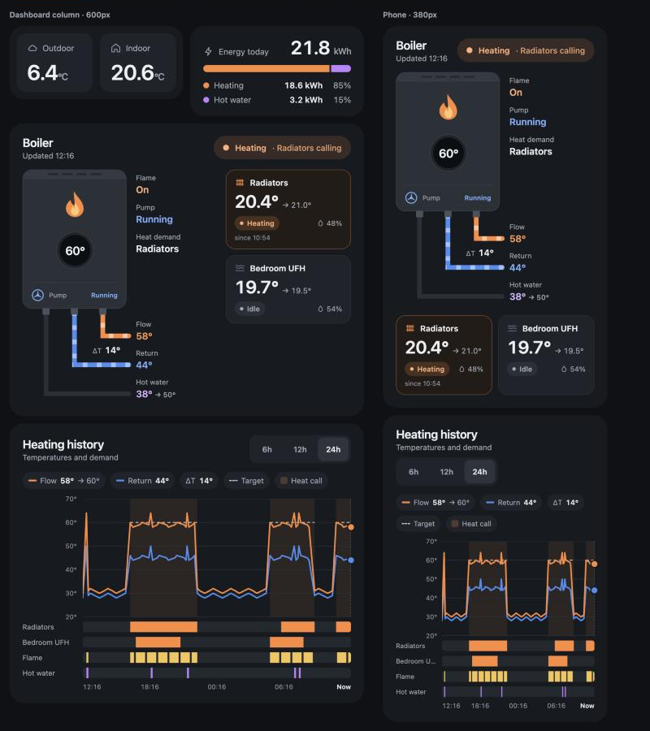

# Boiler Cards for Home Assistant

A set of four dashboard cards for keeping an eye on a gas boiler: a live flow view of the boiler and its heating zones, a heating history chart, outdoor/indoor temperatures, and today's energy use. Each card is responsive, so you can place them anywhere in the dashboard editor and they work on a wall tablet or a phone.

[](https://my.home-assistant.io/redirect/hacs_repository/?owner=fwhitten&repository=ha-boiler-cards&category=plugin)



| Card | What it shows |
| --- | --- |
| `custom:boiler-flow-card` | Boiler with an animated flame, flow target display and pump (on / off / overrun). Flow, return and hot water pipes leave the bottom of the boiler and animate while water moves, with ΔT between flow and return. Heating zone tiles show current and target temperature, humidity, and Heating or Idle. |
| `custom:boiler-history-card` | Flow, return and flow target over 6, 12 or 24 hours, with heat-call periods shaded and timelines for each zone, the flame and hot water. |
| `custom:boiler-climate-card` | Outdoor and indoor temperature. |
| `custom:boiler-energy-card` | Today's heating and hot water energy with a split bar. |

Tapping any value opens Home Assistant's more-info dialog for that entity.

## Installation

### HACS (recommended)

1. Click the **Open your Home Assistant instance** button above, or in HACS open the menu ⋮ → **Custom repositories** and add `https://github.com/fwhitten/ha-boiler-cards` with type **Dashboard**.
2. Download **Boiler Cards**.
3. Reload your browser. HACS adds the dashboard resource for you.

### Manual

1. Copy `dist/boiler-cards.js` to `/config/www/boiler-cards.js`.
2. In **Settings → Dashboards → ⋮ → Resources**, add `/local/boiler-cards.js` as a **JavaScript module**.
3. Reload your browser.

## Configuration

All four cards appear in the card picker. The main entities can be set in the visual editor; heating zones are set in the YAML editor.

### Heating zones

The flow card and the history card share the same `zones` list, so you can paste it into both.

```yaml
zones:
  - name: Radiators
    climate_entity: climate.radiators              # current/target temperature, humidity
    heat_call_entity: binary_sensor.radiators_call # optional: on while calling for heat
    humidity_entity: sensor.hallway_humidity       # optional: if the thermostat has no humidity
    icon: radiator                                 # radiator | underfloor
  - name: Bedroom UFH
    climate_entity: climate.bedroom_ufh
    icon: underfloor
```

A zone counts as **Heating** when `heat_call_entity` is on. Without one, the card uses the thermostat's `hvac_action` (`heating`). Humidity comes from `humidity_entity`, or the thermostat's `current_humidity` attribute.

### Live flow card

```yaml
type: custom:boiler-flow-card
title: Boiler
flow_temp_entity: sensor.boiler_flow_temperature
flow_target_entity: sensor.boiler_flow_target
return_temp_entity: sensor.boiler_return_temperature
dhw_temp_entity: sensor.boiler_hot_water_temperature
dhw_target_entity: sensor.boiler_hot_water_target
flame_entity: binary_sensor.boiler_flame
pump_entity: sensor.boiler_pump
dhw_active_entity: binary_sensor.boiler_hot_water_active   # optional
zones: [...]                                                # see above
```

| Option | Required | Description |
| --- | --- | --- |
| `title` | no | Card title. Default `Boiler`. |
| `subtitle` | no | Text under the title. Default: the time of the last update. |
| `flow_temp_entity` | yes | Flow temperature sensor. |
| `flow_target_entity` | no | Flow target, shown on the boiler's display. A target of 0 shows as `--`. |
| `return_temp_entity` | yes | Return temperature sensor. |
| `dhw_temp_entity` | no | Hot water temperature. Leave out to hide the hot water pipe. |
| `dhw_target_entity` | no | Hot water target (sensor, number, or a `water_heater`). |
| `flame_entity` | no | Flame on/off. |
| `pump_entity` | no | Pump state. `on` / `off` work, and any state containing `overrun` (or `run-on`, `post-run`) shows as overrun. |
| `dhw_active_entity` | no | On while the boiler is making hot water. |
| `infer_hot_water` | no | Default `true`. Without `dhw_active_entity`, hot water is assumed when the flame is on and no zone is calling. |
| `zones` | no | Heating zones, see above. |

**How the mode is worked out.** Hot water if `dhw_active_entity` is on (or inferred as above); otherwise Heating if any zone is calling; otherwise Pump overrun if the pump reports overrun; otherwise Idle. Heating pipes animate while the pump runs (slowly during overrun), and the hot water pipe animates in hot water mode.

On a card wider than about 580px the zones move to a column beside the boiler. On narrower cards they sit underneath.

### History card

```yaml
type: custom:boiler-history-card
flow_temp_entity: sensor.boiler_flow_temperature
flow_target_entity: sensor.boiler_flow_target
return_temp_entity: sensor.boiler_return_temperature
flame_entity: binary_sensor.boiler_flame
dhw_active_entity: binary_sensor.boiler_hot_water_active   # optional
hours_options: [6, 12, 24]
default_hours: 24
zones: [...]
```

| Option | Required | Description |
| --- | --- | --- |
| `title` | no | Default `Heating history`. |
| `flow_temp_entity`, `return_temp_entity` | yes | Temperatures to plot. |
| `flow_target_entity` | no | Drawn as a dashed line while a zone is calling (always, if there are no zones). |
| `flame_entity` | no | Adds a Flame timeline. |
| `dhw_active_entity` | no | Adds a Hot water timeline. Without it, hot water is inferred from flame-on time outside heat calls. |
| `hours_options` | no | Range buttons. Default `[6, 12, 24]`. |
| `default_hours` | no | Range shown first. Default: the longest option. |
| `refresh_minutes` | no | How often history is re-fetched. Default `5`. |
| `zones` | no | One timeline per zone, plus heat-call shading on the chart. |

History comes from Home Assistant's recorder, so entities you exclude from the recorder won't have a history line.

### Climate card

```yaml
type: custom:boiler-climate-card
outdoor_entity: sensor.outdoor_temperature
indoor_entity: sensor.indoor_temperature
outdoor_name: Outdoor   # optional
indoor_name: Indoor     # optional
```

`indoor_entity` can also be a `climate` entity; its `current_temperature` is used.

### Energy card

```yaml
type: custom:boiler-energy-card
heating_entity: sensor.boiler_heating_energy
hot_water_entity: sensor.boiler_hot_water_energy
mode: auto   # auto | statistics | state
```

| `mode` | Behaviour |
| --- | --- |
| `auto` (default) | Ever-increasing meters (`state_class: total` or `total_increasing`) use today's change from long-term statistics. Other sensors, such as ones that reset daily, are shown as they are. |
| `statistics` | Always use today's change from long-term statistics. |
| `state` | Always show the sensor's value as it is. |

Wh and MWh are converted to kWh.

## Theming

The cards use their own dark palette. You can override the main colours with a theme or card-mod:

| Variable | Default |
| --- | --- |
| `--boiler-card-background` | `#171A1F` |
| `--boiler-card-tile` | `#1F242B` |
| `--boiler-card-text` | `#EEF1F4` |
| `--boiler-card-font` | inherits the dashboard font |

Animations stop when the device has **reduce motion** turned on.

## Trying it without Home Assistant

`demo/index.html` loads the cards with mock data and lets you switch between heating, hot water, pump overrun and idle states:

```bash
python3 -m http.server 8765
```

Then open <http://localhost:8765/demo/>.

## Licence

MIT
